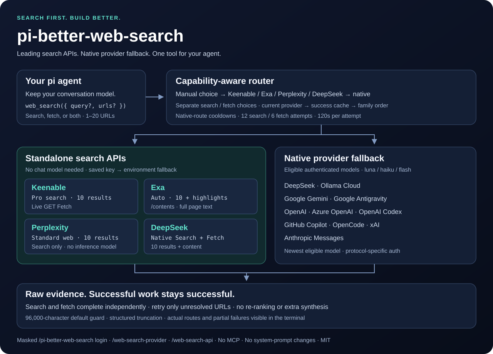
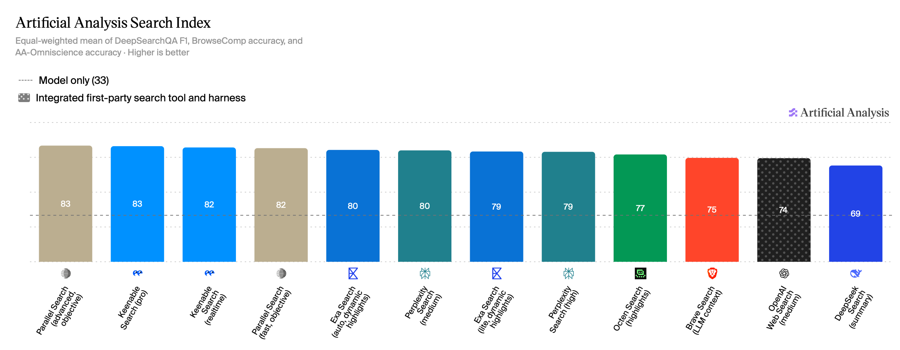

# pi-better-web-search

**One tool. Every provider. Raw results.**

A [pi](https://pi.dev) extension that adds exactly one model-callable tool:
`web_search`. Search with **Keenable, Exa, Perplexity, or DeepSeek**, fetch URLs
when supported, and automatically fall back across authenticated native
providers. Keep your conversation model; get provider results as-is.

[](https://github.com/zhexusun10/pi-better-web-search/actions/workflows/ci.yml)
[](https://www.npmjs.com/package/pi-better-web-search)
[](LICENSE)
[](docs/testing.md)
[](https://nodejs.org)

[简体中文](docs/README.zh-CN.md) · [Search APIs](docs/search-apis.md) · [Architecture](docs/architecture.md) · [Providers](docs/providers.md) · [Testing](docs/testing.md)

## How it works



Your agent calls `web_search` with a query, URLs, or both. The router honors
per-phase provider preferences, tries configured search APIs, and falls back to
eligible native providers. Search and fetch keep their successful results
independently; raw provider data goes straight back to the agent.

## Search is an agent superpower

**33 without search. 83 with Keenable Pro. A 50-point leap.**

The Artificial Analysis Search Index makes the difference visible: the dashed
**model-only baseline is 33**, while **Keenable Pro reaches 83**, with Exa and
Perplexity at **80**. All three independent providers score ahead of the
integrated **OpenAI Web Search result at 74** in this snapshot.



*Source: [Artificial Analysis Search Index](https://artificialanalysis.ai/agents/search-api),
15 Nov 2026 screenshot. Scores combine DeepSearchQA F1, BrowseComp accuracy and
AA-Omniscience accuracy. [Methodology](https://artificialanalysis.ai/methodology/search-api).*

For a coding agent, the web is working memory at internet scale: official docs,
existing libraries, battle-tested implementations, migration guides, and fixes
for the exact error in front of it. **An agent should not spend thousands of
tokens rediscovering a solution someone has already published.** One well-placed
`web_search` call can surface the right API, package, or fix—turning repeated
trial and error into a direct path to a successful task, with fewer wasted tokens.

### 1.0: An epic release for the pi open-source community

Built to be the web-search tool you reach for first:

- **Search specialists, not just model-provider search.** Keenable Pro,
  Exa highlights, Perplexity's standard web Search API, and native DeepSeek.
- **Your model, your search engine.** Standalone APIs work independently of the
  conversation model. Log in once in a masked terminal dialog and start searching.
- **Search → read → build.** Search for solutions, fetch the primary sources,
  and implement with evidence. One tool, just `query` and optional `urls`.
- **Resilient by design.** Independent search/fetch preferences, automatic
  cross-provider fallback, cooldowns, and per-URL recovery that keeps successes.
- **A thin, open-source integration.** Raw provider results, no extra synthesis
  pass, no MCP server, no new runtime dependency, no system-prompt modifications.

## Install and search

**Version 1.0.2 is available.** [Release notes and package download](https://github.com/zhexusun10/pi-better-web-search/releases/tag/v1.0.2).

```bash
pi install npm:pi-better-web-search
```

Then start a new pi process, or run `/reload` in an existing session. In pi's terminal:

```text
/pi-better-web-search login
```

Choose **Keenable, Exa, Perplexity, or DeepSeek**, paste your key into the hidden
input, and press Enter. The API is available immediately—no chat-model setup
or environment-variable ceremony. Already have an eligible authenticated native
provider? It works as a fallback too.

Try: *“Find the official migration guide and an existing library for this before
implementing it from scratch.”*

Install the latest source from GitHub, or use a local checkout:

```bash
pi install git:github.com/zhexusun10/pi-better-web-search
pi install ./path/to/pi-better-web-search
```

> Do not load this package together with `pi-web-search`. Both register a tool
> named `web_search`, and the second registration replaces the first.

Requirements: **pi 1.3+** and **Node.js 22.19+**. **Pi 1.5.2 verified** with
type checking and automated tests against pi 1.5.2 host dependencies.

## What makes it better

A focused tool with the reliability features an agent actually needs:

- **One tool, not two.** There is no separate `url_context` tool. URL analysis
  is the optional `urls` field on `web_search`. No skills are installed,
  registered, or shipped; model-facing guidance stays in the tool description
  and parameter schema.
- **Correct exposure.** The tool is hidden when the current model has no
  compatible search interface and no compatible provider is authenticated. A
  configured dedicated search API, pi-authenticated DeepSeek tools, or an
  authenticated lightweight model exposes it.
- **Automatic fallback.** If the current model cannot search, or a provider
  call fails, the extension tries other authenticated provider interfaces until
  one succeeds.
- **Remembered interfaces.** The successful search and fetch providers are
  cached under pi's agent directory. The next call uses the remembered
  interface when the current model cannot search.
- **Fresh discovery.** Adding or removing a provider, login, API key, or
  available model changes the cache fingerprint, so old preferences are not
  blindly reused.
- **Dynamic URL field.** `urls` is exposed only when at least one usable
  provider supports URL analysis. `urls` can be used alone or with `query`.
- **Raw results.** Provider data is returned in a JSON wrapper without
  deduplication, URL normalization, junk filtering, re-ranking, summarization,
  citation-marker insertion, or appended Sources sections. A final character
  guard applies structured truncation only to oversized output.
- **Capability-aware guidance.** The description covers current information,
  fact-checking, source verification/citation, and refining a search when evidence
  is insufficient. It mentions fetch only when usable. The schema prefers
  natural-language queries and makes clear that `urls` does not require `query`.
- **No system prompt changes.** The extension does not add prompt snippets,
  guidelines, loadout hooks, providers, MCP servers, or other tools.
- **Native DeepSeek Search/Fetch.** DeepSeek uses the documented
  `/v1/tools/search` and `/v1/tools/fetch` endpoints with Bearer auth.

## Tool semantics

The runtime schema is logically:

```ts
{
  query?: string;
  urls?: string[];
}
```

- `query` searches the web. Outer whitespace is trimmed; search operators are
  otherwise passed through unchanged. If DeepSeek is selected and the query
  exceeds 128 Unicode characters, the tool returns an error with the actual
  length and limit, asking the model to shorten the query and retry. It does not
  send the query or silently truncate it. Other providers may accept longer queries.
- `urls` analyzes the listed pages. URLs can be used **alone** or together with
  `query`. A query plus URLs performs a separate web search and then analyzes
  the URLs. Omit `query` when only fetching the supplied URLs.
- If supplied, `urls` must contain **1–20** non-empty strings, each at most
  **8192 Unicode characters**.
- Both schema variants reject extra arguments (`additionalProperties: false`);
  runtime validation also rejects unknown fields such as `model`, `provider`,
  and `mode` before any provider request.
- At least one non-empty `query` or one valid URL is required. This rule is
  enforced at runtime rather than with a top-level `anyOf`, for compatibility
  with all model providers.
- The `urls` field is hidden when no usable interface supports URL analysis. In
  that configuration `query` is required, and its description contains no
  URL/fetch guidance.
- Search and URL analysis may use different providers in the same call.
- Research can use explicit follow-up calls: search, inspect the evidence, refine
  the query if needed, then fetch relevant sources when available. There is no
  automatic fixed search chain or global query-length cap from the skills; see
  [query length and chained calls](docs/search-skills.md#query-length-and-chained-calls).

Search and URL fetching complete independently: a successful search (including
zero results) or any successful URL fetch is returned even if the other work
fails or lacks an interface. Search failures appear in `search.error`; URL
failures appear in `fetched[].error`. Successful provider data is not replaced
by a whole-call error. Only invalid request structure or no successful requested
operation produces a tool error (`isError: true`). Explicit cancellation still
stops immediately.

### Agent-visible returns

All final content blocks use `type: "text"`; there are no separate success,
partial, or failure content types:

| Outcome | Agent-visible text | `isError` |
|---|---|---|
| Success | JSON containing the raw search and/or fetched data | omitted |
| Partial success | JSON retaining successful data plus `search.error` and/or `fetched[].error` | omitted |
| Complete failure | `Failed: ...` with actionable errors | `true` |

A search-only DeepSeek query-length rejection uses the actionable message
without the `Failed: ` prefix. For combined requests, the same message is in
`search.error` if fetching succeeds. Oversized JSON is guarded as documented
below and may end with `[truncated]`. Progress uses `onUpdate`, not an additional
final return type.

## Dedicated search APIs

**Already logged into official DeepSeek with pi's `/login`, or configured its key
in pi's `models.json`? No second login is needed.** The extension reuses pi's
`deepseek` provider credentials for native Search/Fetch, even if the available chat
catalog is empty or has no `flash` model. Select it with `/web-search-provider fetch`
or `/web-search-provider search`. No inference model is invoked and no key is copied.
Third-party gateways merely hosting DeepSeek models are not treated as the official API.

Run **`/pi-better-web-search login`** in pi's terminal, choose **DeepSeek, Exa,
Keenable, or Perplexity**, then paste/type the API key into the **hidden input**
and press Enter. The key is saved separately from settings/cache, and the API
becomes available immediately without restarting pi or configuring a chat model.
Saved keys override environment keys. Esc cancels without changing anything.

`/pi-better-web-search status` shows presence only; `/pi-better-web-search logout`
removes a saved key and disables its standalone API. Keys are stored in
`<pi agent dir>/better-web-search-auth.json` (restricted file permissions,
**not encrypted**). Never commit/share that file or paste keys into chat or
command arguments. Environment variables remain an optional fallback.
`/web-search-api` manages enable/disable flags; `/web-search-provider` selects
per-phase preferences. Keenable public access still requires explicit consent.
No new dependency or MCP server is installed.

Perplexity uses only `POST /search` with **`search_type: "web"` (not fast)**,
without any effort/preset/model; it does **not** support Fetch. Keenable uses
`mode: "pro"` search plus live GET Fetch. Exa returns search highlights and
fetches full page text via `/contents`; DeepSeek uses native Search/Fetch.

| Standalone API | Search configuration | URL fetch |
|---|---|---|
| **Keenable** | Pro, 10 results | Live GET Fetch |
| **Exa** | Default auto, 10 results + highlights | Full-text `/contents` |
| **Perplexity** | Standard web, 10 results; no inference model | Not supported |
| **DeepSeek** | 10 results + content | Native `/v1/tools/fetch` |

Priority is **manual preference → Keenable → Exa → Perplexity → standalone
DeepSeek → automatic native routing**. Fetch skips
Perplexity. See [API setup, protocol and privacy details](docs/search-apis.md).

## Provider support

Beyond the **four standalone APIs** above, keep access to **10 native provider
classes plus Anthropic Messages**, with credential discovery and protocol-specific
routing:

| # | Provider Class | Web Search | URL Analysis | Native Protocol & Endpoint |
|:---:|---|:---:|:---:|---|
| 1 | **DeepSeek** | Yes | Yes | Native REST `/v1/tools/search` & `/v1/tools/fetch` |
| 2 | **Google Gemini** | Yes | Yes | `google-generative-ai` SSE `google_search` grounding & `url_context` |
| 3 | **Google Antigravity** | Yes | Yes | Antigravity enterprise Vertex endpoint & wrapper body |
| 4 | **Ollama Cloud** | Yes | Yes | Hosted REST `/api/web_search` & `/api/web_fetch` (`ollama.com`) |
| 5 | **OpenAI** | Yes | No | Official Responses API `web_search` tool (`openai-responses`) |
| 6 | **Azure OpenAI** | Yes | No | Azure Responses API (`azure-openai-responses`) |
| 7 | **OpenAI Codex** | Yes | No | Specialized `/codex/responses` with Codex account tokens & headers |
| 8 | **GitHub Copilot** | Yes | No | Responses routing with Copilot auth tokens & proxy endpoints |
| 9 | **OpenCode** | Yes | No | Responses routing with Pi session tracking headers |
| 10 | **xAI (Grok)** | Yes | No | Grok dialect Responses API (`web_search_call.action.sources`) |
| * | **Anthropic Messages** | Yes | No | Messages API `web_search_20260209` tool & Claude Code OAuth |

OpenAI search supports both Pi's **OpenAI (ChatGPT subscription) / Sign in with
ChatGPT** OAuth login and an OpenAI API key, as well as the separate legacy
**OpenAI Codex** OAuth login. Model and web search availability still depend
on the account and service. Pi virtual models (`pi-virtual`) are not directly
supported; automatic fallback can still use an authenticated concrete model.

URL analysis is only exposed when at least one usable interface supports it.
For example, a current OpenAI model with only OpenAI credentials gets a
query-only schema, while the same session with DeepSeek, Ollama Cloud, or Google
credentials also gets `urls`.

Provider detection follows the authenticated model's provider/API:

1. `deepseek` provider (DeepSeek native search/fetch)
2. Antigravity or Google Generative AI (Google Gemini & Google Antigravity)
3. Ollama Cloud (`ollama-cloud` provider or exact `ollama.com` host)
4. xAI with `openai-responses` (xAI Grok)
5. OpenAI-compatible Responses APIs (OpenAI, Azure OpenAI, OpenAI Codex, GitHub Copilot, OpenCode)
6. Anthropic Messages (Claude)

All four standalone APIs support masked terminal login or environment-key
fallbacks. `/web-search-api [deepseek|exa|keenable|perplexity]` manages their
enable/disable settings. The model-facing tool still has only `query` / `urls`.
See [dedicated API setup](docs/search-apis.md) and the
[Exa vs Keenable integration notes](docs/search-skills.md).

See [Providers](docs/providers.md) for request shapes, auth quirks, and URL
support per family.

## Choose providers in the terminal

Run `/pi-better-web-search` or `/pi-better-web-search help` to list all terminal
commands, including login, search/fetch preferences, and API enable/disable settings.

Run `/web-search-provider` to choose a preferred provider separately for
**Web Search** and **URL Fetch**. Or open either picker directly:

```text
/web-search-provider search
/web-search-provider fetch
```

The picker lists usable standalone APIs and authenticated native providers with
eligible lightweight models that support the selected operation. Choose **Auto** to restore automatic selection;
Esc leaves the setting unchanged. Selecting a provider does not change the
conversation model or the model-facing tool schema.

A manual choice is a **preference, not a lock**: the standalone API or newest
eligible native model is tried first, even after a previous failure or
Retry-After. Errors, timeouts, or an unavailable provider still fall back to
remaining candidates. URL fetching still retries only unresolved URLs. Input
validation and cancellation retain their existing behavior.

Choices persist across sessions in `~/.pi/agent/better-web-search-settings.json`
(respects `PI_CODING_AGENT_DIR`; override with `PI_BETTER_WEB_SEARCH_SETTINGS`):

```json
{ "version": 1, "search": "openai", "fetch": "deepseek" }
```

Only provider ids and API enable/disable toggles are saved, never credentials.
These settings are separate
from the automatic success cache: fallback successes and fingerprint changes
never overwrite them. Unavailable choices are ignored until eligible again.

## Automatic selection and fallback

Dedicated retrieval APIs have no chat-model tier and can expose the tool on
their own. For model-backed interfaces, only lightweight models are eligible:
**OpenAI = `luna`, Claude = `haiku`,
all other brands (including DeepSeek) = `flash`**. This is a strict allowlist,
not live price detection. It applies to model-backed search, URL analysis,
current models, cache hints, and fallback. Pi-authenticated DeepSeek native tools
are an API-only exception: they use no inference model and need no `flash` id.
Without an eligible model, pi-authenticated DeepSeek tools, or a standalone API,
the tool stays hidden; it never silently upgrades to another inference-model tier.

After any explicit provider preference, configured **Keenable → Exa →
Perplexity → standalone DeepSeek** APIs are tried first (Fetch skips Perplexity),
followed by this automatic ordering:

1. The newest eligible model of the current conversation's provider is tried
   first, subject to provider/model failure cooldowns. The conversation model
   itself is not privileged over a newer lightweight sibling. An unsupported
   conversation API does not discard this provider preference.
2. A remembered successful provider from the preference cache is tried next
   when the cache fingerprint is current, reselecting its newest eligible model.
3. The remaining provider families are tried in this fixed order:
   **DeepSeek → Ollama → Google → OpenAI → xAI → Anthropic**.
4. Within a family, brand order comes first: DeepSeek, OpenAI, Claude,
   Gemini/Gemma, then other gateway brands. Within a brand's lightweight tier,
   numeric versions sort newest first: `6.1 > 6`, `5.10 > 5.5`. Claude supports
   both dotted and dashed versions, ignoring date suffixes. Gateway models are
   classified by brand, not API family. Ties are deterministic.
5. Alternate providers are considered before additional models of an already
   represented provider; siblings are then tried round-robin across families.
   A provider-wide failure skips that provider, while a model-specific failure
   (including a model-specific 403) can fall back to a sibling.

Search and URL fetching each allow one initial attempt plus at most 6 fallback
attempts (7 actual attempts per phase); skipped candidates do not consume the limit.
Model ranking applies only to supported APIs: for example, the built-in
`opencode-go` DeepSeek models use `openai-completions`, which this extension
cannot search through and does not reinterpret as Responses.

Versions are discovered from pi's available authenticated models, not a
hardcoded list or an external catalog lookup. Older lightweight models can be
fallbacks, but `terra`, `sol`, `astra`, `sonnet`, `opus`, `pro`, base models,
and unknown tiers are not substitutes for the required lightweight tier.

If a provider errors, the extension records the attempt and moves to the next
interface. An overlong query rejected by DeepSeek stops search fallback without
trying another search provider or updating its health state; independently
requested URL fetching still runs. Aborts stop immediately. Each search or URL
fetch attempt waits up to 60 seconds for HTTP response headers or provider output.
After headers, a separate 60-second inactivity deadline waits for output. Each
non-empty response body chunk or provider event resets it, so active streams are
not cut off due to their total duration. SSE keepalive comments do not count as
output. User cancellation and provider errors still stop the attempt. Set
`PI_BETTER_WEB_SEARCH_TIMEOUT_MS` to override both deadlines (integer milliseconds
from 1 to 2,147,483,647; invalid values use the default). If every attempt fails, the tool returns an error whose message
contains the provider errors. DeepSeek/Ollama preserve completed URLs if a later
request hits a global HTTP or transport error, retrying only unresolved URLs.
Provider/model routing remains in `details.attempts`. For a URL-only call, the
error also reports the per-URL failures. Provider error bodies and model-facing
error text are bounded to prevent an oversized error from filling the context.
Individual SSE frames (including unfinished lines) are limited to 4,194,304
UTF-16 code units; an oversized frame triggers fallback rather than unbounded
buffering. This is not a total stream-size limit.

Provider-wide failures (auth, balance, network, timeout, malformed request) and
model-specific failures are remembered for the life of the extension process.
On later calls, model-backed automatic routes are moved behind healthy model routes
for search and fetch independently. Explicit preferences and standalone API order
are not displaced by health cooldowns. The cooldown starts at 60 seconds, doubles
when a subsequent attempt after expiry fails, and is capped at 10 minutes.
Concurrent failures during the same cooldown do not extend it; a successful
search or a fetch with at least one successful URL and no provider transport
error clears it. Set
`PI_BETTER_WEB_SEARCH_FAILURE_COOLDOWN_MS=0` to disable this behavior. Calls
already in flight may still try the same candidate at the same time.

### Cache fingerprint invalidation

The preference cache is stamped with a fingerprint of all authenticated chat
models known to pi, derived from sorted `provider/model@baseUrl` values. Adding
or removing a provider, login, API key, or available model changes the
fingerprint. A changed fingerprint means:

- the old cached provider is **not** used as the first choice;
- automatic discovery starts again from the current provider and family priority,
  after any usable explicit preference;
- the cache is rewritten only after the next successful search/fetch;
- stale, unverified preferences are not carried into the new fingerprint.

A cache entry is only a hint. Credentials are resolved again on every call, and
the referenced provider must still be available and support the operation.

## Terminal display

The tool name remains `web_search`, but the terminal title distinguishes
**Web Search**, **Web Fetch** (URLs only), and **Web Search + Fetch**. The result
shows the actual successful operation and interface; expand it to see the raw
provider output. DeepSeek and Ollama use standalone APIs without a `model`
request parameter, so they display e.g. `Fetch: deepseek API /v1/tools/fetch`,
not a chat model name. `details.routes` records these interfaces; native API
routes omit `model`. Older `details.model`/cache fields identify the credential
selection candidate, not an inference model used by those native APIs.

If an older model/search label persists, reload or restart pi and check that
`pi-web-search` is not also loaded; both extensions register `web_search`.

## Cache

Default path:

```text
~/.pi/agent/better-web-search.json
```

The path respects pi's `PI_CODING_AGENT_DIR` setting. Override it directly with:

```bash
export PI_BETTER_WEB_SEARCH_CACHE=/path/to/better-web-search.json
```

Example contents:

```json
{
  "version": 1,
  "fingerprint": "0123456789abcdef0123456789abcdef",
  "search": { "provider": "deepseek", "model": "deepseek-v4-flash" },
  "fetch": { "provider": "ollama-cloud", "model": "qwen-4-flash" }
}
```

Only provider and model identifiers plus the fingerprint are stored. API keys,
OAuth tokens, and other credentials are never written to this file.

To clear the remembered preferences, delete the file:

```bash
rm ~/.pi/agent/better-web-search.json
```

A missing, unreadable, or corrupt cache is treated as empty and never breaks a
tool call.

## Raw provider results

Provider content is returned in a JSON wrapper, with known billing, request
tracking and timing fields omitted from standalone API responses. Search results,
page text and source evidence retain their provider fields. A search looks like
this:

```json
{
  "query": "the query",
  "search": {
    "answer": "provider text when available",
    "results": "the provider's raw results",
    "citations": "the provider's raw citations",
    "searchQueries": ["provider query"],
    "groundingMetadata": "raw provider metadata"
  },
  "fetched": [
    {
      "url": "https://example.com",
      "data": "the provider's raw fetch payload"
    }
  ]
}
```

- Duplicate URLs are not deduplicated.
- Tracking parameters and junk-looking URLs are not normalized or filtered.
- Results are not re-ranked or summarized.
- Citation markers are not inserted, and no "Sources" or "Additional results"
  sections are appended.
- Redirects are not resolved and sources are not derived.
- Known standalone API bookkeeping is omitted: Keenable `usage`, Perplexity
  `id` / `server_time`, and Exa `requestId` / `costDollars` / `searchTime` /
  `warnings` / `resolvedSearchType`. Exa `notices` remain available to the model.
  See [response metadata handling](docs/search-apis.md#interfaces).
- Unknown provider fields are preserved when the result fits the size guard.

A final output-size guard limits model-facing results and errors to **96,000
Unicode code points** by default. Normal-sized results retain their original
fields and formatting. If indentation alone exceeds the limit, compact JSON is
returned without dropping data or setting the truncation flag.

When even compact JSON is too large, the guard allocates space across sibling
fields and array entries, redistributing unused space. Recognized link and
identity fields (`url`, `uri`, `href`, `link`, `title`, `name`, `id`, and common
aliases) stay complete; if they cannot fit, the associated entry or branch is
omitted instead. Standalone URLs and entries in link/citation arrays also stay
whole. When a text cut would split a recognizable embedded URL token (such as
`https://`, `mailto:`, or `www.`), the incomplete token is omitted. Relative
links or bare domains in unrecognized fields cannot always be identified. Other long strings may be shortened, and fields or trailing array
entries omitted; results are not re-ranked or summarized.

The JSON portion remains valid, followed by a single `[truncated]` line. No
output-size truncation metadata or per-string markers are added to the JSON.
Because of the trailing line, the complete text is not itself valid JSON.
`details.truncated` is also set to `true` when data is actually removed.

Change the limit **before starting pi**:

```bash
export PI_BETTER_WEB_SEARCH_MAX_CHARS=100000
```

In PowerShell, use `$env:PI_BETTER_WEB_SEARCH_MAX_CHARS = "100000"`. The limit
is in code points, **not tokens**, and does not adapt to the current model's
context window. The marker counts toward the limit. If truncation is needed and
the limit is 11–13 characters, only `[truncated]` is returned; below 11
characters the marker does not fit and only a minimal JSON value is returned.
`details.truncated` remains true in both cases. There is no continuation or
pagination cache: retry individual URLs or raise the limit if more content is
needed.

## Exposure rules

`web_search` is exposed when either:

- the current conversation model is lightweight and supports a provider-native
  search interface; or
- at least one authenticated available lightweight model maps to a supported
  provider family; or
- pi has configured official `deepseek` provider credentials for native
  Search/Fetch (no available chat model or `flash` id needed); or
- a dedicated search API is configured and usable (no chat model needed).

For model-backed interfaces the same lightweight restriction applies to `urls`;
standalone Keenable, Exa, and DeepSeek, plus pi-authenticated DeepSeek native
tools, expose it without a chat-model tier.

For an unsupported current model with no compatible login or API key, the tool
stays hidden (removed from the active tool set). The extension never calls an
unauthenticated provider. When the set of available providers or credentials
changes, the extension re-evaluates and re-registers the same `web_search` name
with the appropriate schema variant.

## DeepSeek native Search/Fetch API

This package supports DeepSeek's native search and fetch APIs. The older
project's Anthropic-compatible DeepSeek chat route is **replaced** by this
native API; DeepSeek models are routed to it even when their underlying chat API
is Anthropic Messages compatible.

```text
POST https://api.deepseek.com/v1/tools/search
POST https://api.deepseek.com/v1/tools/fetch
Authorization: Bearer <DeepSeek API Key>
Content-Type: application/json
```

Search uses `query`, `count: 10`, and `need_content: true`. DeepSeek limits
`query` to 128 Unicode characters. Longer queries return an error before any
DeepSeek request is sent; the model should shorten the query and retry. For
example: `Search query is too long (129 Unicode characters). The maximum is
128 Unicode characters. Shorten the query and retry.` The raw `results` array
is returned unchanged,
including `rerank_score`, `title`, `url`,
`snippet`, `summary`, `content`, `site_name`, `site_icon`, `date`, `authority`,
and any unknown fields.

Fetch sends `{ "url": "..." }` and preserves the raw `{ title, content }`
response. URLs must be at most 8192 characters, use HTTP/HTTPS, include a host,
and omit credentials.

DeepSeek errors use the OpenAI-compatible error shape. Search errors and global
fetch errors switch providers; `403` and `404` fetch failures are reported
against the individual URL so the orchestrator can retry only that URL elsewhere.

See [Providers](docs/providers.md#deepseek) for the full request, response, and
error details.

## Security and privacy

- Native model credentials use pi's registry. Standalone API keys can be saved
  through the masked terminal login in a separate restricted-permission,
  unencrypted credential file; saved keys precede environment fallbacks.
  Settings/cache never contain keys. Never commit/share the credential file.
- The cache stores only provider/model identifiers and a fingerprint.
- Search queries and requested URLs are sent to the selected provider's API.
- The extension has no telemetry, analytics, or third-party service of its own.
- A call may use an authenticated provider other than the current conversation
  model, which can incur usage on that provider.
- Provider error text and tool results can contain request identifiers or page
  content. Redact them before sharing logs or session exports.

See [SECURITY.md](SECURITY.md) for reporting vulnerabilities.

## Verified

- **Pi 1.5.2 verified**: type checking and automated tests against pi 1.5.2
  host dependencies, with CI passing on Node.js 22 and 24.
- **Unit and integration tests** covering exposure, schema variants,
  provider request shapes, SSE parsing, raw-result preservation, fallback,
  cache invalidation, URL handling, truncation, and abort behavior.
- **Real DeepSeek Search/Fetch run** with a real API key: 10 raw search results,
  summaries and content, valid fetch payloads for normal pages, and documented
  errors for 404 and invalid URLs.
- **Real pi process end-to-end run**: a mock unsupported current model plus
  DeepSeek credentials exposed `web_search`, called it, auto-switched to the
  native DeepSeek API, returned 10 raw results, and answered with the tool
  result attached.
- Other provider families are covered by unit/integration tests with mocked
  requests and streams; live credentials for every provider are not required.

The opt-in live DeepSeek test is reproducible from a repository checkout:

```bash
DEEPSEEK_API_KEY=... npm run test:live:deepseek
```

## Compatibility

- **pi 1.3+**. The extension uses the current extension tool and model registry
  APIs.
- **Node.js 22.19+**. Pi loads the TypeScript extension directly; there is no
  compile step.
- Pi provides `@earendil-works/pi-coding-agent`, `@earendil-works/pi-ai`, and
  `typebox` as host packages. They are declared as peer dependencies and are
  not bundled.
- Upstream provider API changes may require adapter updates. Unknown provider
  fields are preserved rather than rewritten.

## Development

```bash
npm ci --ignore-scripts
npm run check
npm test
npm run verify:package
npm run build
```

`npm run build` runs the checks and tests, verifies the npm file list, and packs
`dist/pi-better-web-search-1.0.2.tgz`. Nothing is published automatically.

The test suite uses plain `.mjs` files that import the `.ts` sources directly.
It mocks `globalThis.fetch`, uses a temporary cache file, and exercises
exposure, fallback, cache invalidation, raw-result preservation, truncation,
URL handling, and provider switching.

See [Testing](docs/testing.md) for live-provider tests and the real pi
end-to-end procedure. See [Publishing](docs/publishing.md) for the release
checklist.

## Contributing

Use English for issues, pull requests, and primary documentation. Chinese
translations are welcome. Read [CONTRIBUTING.md](CONTRIBUTING.md) before
changing provider behavior, exposure rules, or output handling.

The extension keeps one invariant above all others: **trust the provider's
result**. Do not add cleanup that rewrites, filters, re-ranks, summarizes, or
reconstructs provider data.

## License

MIT. An independent community package, not an official Pi product.

The `web_search` extraction is derived from the MIT-licensed
[`pi-web-search`](https://github.com/ttttmr/pi-web-search) project. The
repository structure and documentation conventions are inspired by
[`pi-trim`](https://github.com/zhexusun10/pi-trim).
