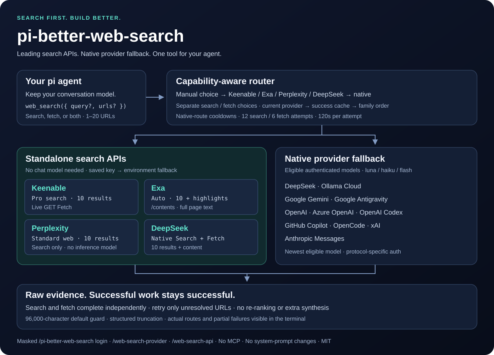
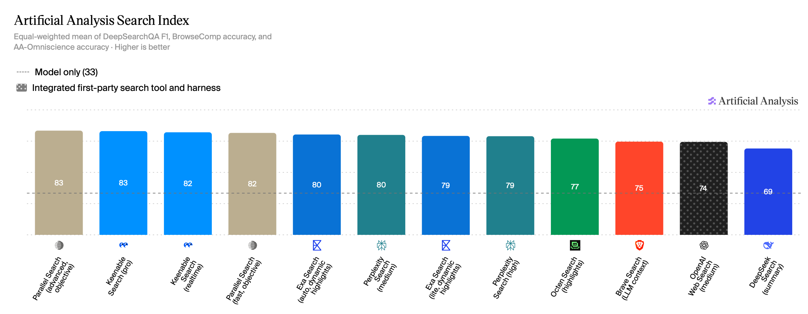

# pi-better-web-search

**一个工具，所有 provider，原始结果。**

这是一个 [pi](https://pi.dev) 扩展，只新增一个模型可调用的工具：`web_search`。
使用 **Parallel、Keenable、Exa、Perplexity 或 DeepSeek** 搜索，在支持时抓取 URL，
并在已认证的原生 provider 之间自动回退。不换对话模型，provider 数据原样返回。

[](testing.md)

[English](../README.md) · [搜索 API](search-apis.md) · [架构说明](architecture.md) · [Provider 细节](providers.md) · [测试](testing.md)

## 插件具体在做什么



Agent 调用 `web_search`：普通模式传入 `query` / `urls`，启用 Parallel 时传入
Parallel 的 `objective` / `search_queries` / `urls`。路由器尊重各阶段的 provider 首选，
重点使用 Keenable 和 Parallel；只有普通模式才会回退到合格的原生 provider。
搜索和抓取分别保留成功结果，provider 的原始数据直接交回 agent。

## Search，是 agent 的巨大 buff

**不搜索：33 分。Parallel Search（advanced，objective）与 Keenable Pro：83 分。**
在这张 Artificial Analysis Search Index 快照中，Parallel 已位居最高分；Parallel
的 fast objective 模式为 82 分，Exa 为 80 分，Perplexity 为 80 分。

Artificial Analysis Search Index 把差距画得很直观：独立搜索工具把高质量的网页证据
直接交给 agent，不让模型只依赖记忆。



*来源：[Artificial Analysis Search Index](https://artificialanalysis.ai/agents/search-api)，
2026 年 11 月 21 日截图；综合 DeepSearchQA F1、BrowseComp 准确率和 AA-Omniscience
准确率。[评测方法](https://artificialanalysis.ai/methodology/search-api)。*

对 coding agent 来说，互联网就是超大规模的外部工作记忆：官方文档、现成的库、
经过验证的实现、迁移指南，以及眼前这个报错的解决方案。
**网上已经有的答案，不值得让 agent 再花几千个 token 猜测、试错和重复实现。**
一次恰到好处的 `web_search`，就能找到正确的 API、可复用的包或有效修复，
用更少的无效 token，把任务做对。

### 1.0：献给 pi 开源社区的一次史诗级升级

冲着成为你首选的 Web Search 工具而来：

- **搜索专家，而不只是模型厂商的附属搜索。** Parallel advanced Search、Keenable Pro、
  Exa highlights、Perplexity 标准 Web Search，以及 DeepSeek 原生 Search/Fetch。
- **Parallel 启用时使用官方 agent schema。** Parallel 使用 `objective`、
  `search_queries` 和 `urls`；由于它与普通的 `query` / `urls` contract 不兼容，
  启用 Parallel 后路由锁定 Parallel，不会回退到其他 provider。
- **对话模型与搜索引擎解耦。** 专用 API 不需要注册 chat 模型；终端隐藏输入登录，立即可用。
- **搜索 → 阅读 → 实现。** 先找到现成方案，再按需抓取一手来源；普通模式一个工具，只有
  `query` 和可选 `urls`；Parallel 启用时使用其官方字段。
- **可靠性不是附加功能。** 搜索/抓取独立首选、跨 provider fallback、健康冷却、逐 URL 恢复；
  失败不能吞掉已经成功的数据。
- **轻薄、开源、原汁原味。** 原始结果直接返回，不再套一层总结模型；无 MCP、无新增运行时依赖、
  不修改系统提示词。

## 安装，登录，开搜

**1.0.5 已可用。** [查看更新说明与下载安装包](https://github.com/zhexusun10/pi-better-web-search/releases/tag/v1.0.5)。

```bash
pi install npm:pi-better-web-search
```

安装后重新启动 pi，或在当前会话输入 `/reload`。然后在 pi 终端运行：

```text
/pi-better-web-search login
```

选择 **Parallel、Keenable、Exa、Perplexity 或 DeepSeek**，在隐藏输入框粘贴密钥并按 Enter。
Parallel 会立即使用官方的 `objective` / `search_queries` / `urls` schema。
无需环境变量、重启或对话模型配置。已有合格的原生 provider 登录，在禁用 Parallel 后也能继续作为回退使用。

试试：*“先搜索官方迁移指南和现成可用的库，不要直接从零实现。”*

> **Parallel 模式有意不同。** 启用 Parallel 后，工具 schema 会从 `query` / `urls`
> 切换为官方的 `objective` / `search_queries` / `urls`。搜索必须同时提供
> `objective` 和 1–3 个 `search_queries`；URL 提取可以只传 `urls`，也可以附带
> `objective`。由于两个 schema 不兼容，路由会锁定 Parallel，不会回退到其他 provider。
> 运行 `/web-search-api parallel` 并选择 **Disable**，即可恢复普通 schema 和 provider fallback。

也可以从 GitHub 安装最新源码，或使用本地 checkout：

```bash
pi install git:github.com/zhexusun10/pi-better-web-search
pi install ./path/to/pi-better-web-search
```

> 不要和 `pi-web-search` 同时加载。两者都注册 `web_search`，后注册的会覆盖
> 先注册的。

要求：**pi 1.3+**，**Node.js 22.19+**。**Pi 1.5.2 verified**：已基于 pi 1.5.2
宿主依赖通过类型检查和自动化测试。

## 为什么更好用

工具保持专注，agent 需要的可靠性一个不少：

- **只保留一个工具。** 没有单独的 `url_context`；URL 分析是 `web_search`
  的可选 `urls` 字段。不安装、注册或附带任何 skill；给模型的使用指导只保留
  在工具 description 和参数 schema 中。
- **正确的暴露规则。** 当前模型不支持搜索，且没有任何已登录/已配置 API key
  的兼容 provider 时，工具隐藏。模型接口要求 luna/haiku/flash 轻量档位；
  独立搜索 API 不受此限制。
- **自动 fallback。** 当前模型不能搜索，或某个 provider 调用失败时，自动尝试
  其他已认证的 provider 接口，直到成功。
- **记住成功接口。** 搜索和 URL 抓取的成功 provider 分别缓存。下次当前模型
  不能搜索时，优先使用记住的接口。
- **provider 变化后重新探测。** 新增/删除 provider、登录、API key 或可用模型
  会改变缓存指纹，旧偏好不会盲目复用。
- **动态 `urls` 字段。** 只有至少一个可用 provider 支持 URL 分析时才暴露
  `urls`。`urls` 可以单独使用，也可以和 `query` 一起使用。
- **原始结果。** provider 数据放在 JSON 外层中返回，不去重、不规范化 URL、
  不过滤垃圾 URL、不重排、不总结、不插入 citation 标记、不追加 Sources。
  只有超出最终字符数限制时才进行结构化截断。
- **与能力匹配的使用指导。** description 说明时效信息检索、事实核查、来源验证
  与引用，以及证据不足时细化 query 再搜；只有可用时才指导 fetch。字段描述建议
  明确的自然语言查询，并明确说明 `urls` 不依赖 `query`。
- **不碰系统提示词。** 不添加 prompt snippet、guideline、loadout hook、
  provider、MCP server 或其他工具。
- **DeepSeek 原生 Search/Fetch。** 使用文档中的 `/v1/tools/search` 和
  `/v1/tools/fetch`，Bearer 鉴权。

## 工具语义

运行时的普通 schema 逻辑上为：

```ts
{
  query?: string;
  urls?: string[];
}
```

启用 Parallel 后，schema 会切换为官方格式：

```ts
{
  objective?: string;
  search_queries?: string[]; // 搜索时必填，1–3 条
  urls?: string[];            // 可单独用于提取
}
```

Parallel 搜索必须同时提供 `objective` 和 `search_queries`；URL 提取接受 `urls`，
并可选 `objective`。启用 Parallel 时传入 `query` 会被拒绝。因为两套 contract
不兼容，只会路由到 Parallel，不会尝试其他 provider fallback。使用
`/web-search-api parallel` 禁用后，才会恢复普通 schema。

- `query` 搜索网页，只去掉首尾空白，搜索语法其余部分原样保留。如果选中
  DeepSeek 且 query 超过 128 个 Unicode 字符，工具会直接返回实际长度和上限，
  提示模型缩短后重试；不会发送请求或静默截断。其他 provider 可以接受更长的查询。
- `urls` 分析指定页面。可以**单独使用**，也可以和 `query` 一起使用。两者同时
  提供时，会额外发起网页搜索，再分析 URL；仅抓取指定 URL 时不要传 `query`。
- 提供 `urls` 时必须包含 **1–20** 个非空字符串，每个最多 **8192 个 Unicode 字符**。
- 两种 schema 均设置 `additionalProperties: false`。运行时也会拒绝 `model`、
  `provider`、`mode` 等未知参数，不会静默忽略或发起 provider 请求。
- 必须至少有一个非空 `query` 或一个合法 URL。该规则在运行时检查，不使用
  顶层 `anyOf`，以兼容所有模型 provider。
- 没有可用 URL 分析接口时，`urls` 字段隐藏，`query` 必填，且描述中不会出现
  “仅抓取 URL 时省略 query”等针对不可用能力的提示。
- 同一次调用中，搜索和 URL 分析可以使用不同的 provider。
- 可以由 agent 显式多轮调用：先搜索、阅读结果，必要时细化 query 再搜，再按需
  抓取相关来源；不会自动执行固定次数的搜索链。两个 skill 都没有规定统一的
  query 字数上限，详见 [查询长度与链式调用](search-skills.md#query-length-and-chained-calls)。

搜索和抓取独立完成：搜索成功（即使结果为空），或任意一个 URL 抓取成功，都保留
成功数据，不会因为另一部分失败或缺少接口而吞掉结果。搜索失败写入 `search.error`，
URL 失败写入 `fetched[].error`。只有请求结构非法或没有任何成功操作时，才整体报错
（`isError: true`）。显式取消仍立即停止。

### Agent 可见的返回

所有最终内容块都使用 `type: "text"`，没有单独的 success/partial/error 内容类型：

| 结果 | Agent 可见文本 | `isError` |
|---|---|---|
| 完整成功 | JSON，包含原始搜索结果和/或网页数据 | 不设置 |
| 部分成功 | JSON，保留成功数据，并附 `search.error` 和/或 `fetched[].error` | 不设置 |
| 全部失败 | `Failed: ...`，说明具体原因 | `true` |

仅搜索时，DeepSeek 查询超长直接返回要求缩短重试的文本，不带 `Failed: ` 前缀。
组合调用中若抓取成功，该提示放入 `search.error`，网页数据照常返回。过大输出仍受
字符保护限制，可能以 `[truncated]` 结尾。`onUpdate` 是进行中的状态，不是另一种
最终返回类型。

## 第三方专用 Search API

**已通过 pi 自带 `/login` 登录官方 DeepSeek，或在 pi 的 `models.json` 配置其 key？
无需重复登录扩展。** 插件直接复用 `deepseek` provider 的凭据调用原生 Search/Fetch，
即使可用对话模型列表为空或没有 `flash` 模型，也会显示在搜索/抓取首选菜单中。
运行 `/web-search-provider fetch` 或 `/web-search-provider search` 即可选择。
不调用推理模型，也不复制 key；第三方网关仅提供 DeepSeek 模型不等于官方 API。

直接在 pi 终端运行：

```text
/pi-better-web-search login
```

选择 **Parallel、DeepSeek、Exa、Keenable、Perplexity** 中的一个，在隐藏输入框输入 API key，
按 Enter 保存并立即启用；按 Esc 取消。无需设置环境变量、重启或先配置对话模型。
保存的密钥优先于环境变量，原有手动 provider 首选和 fallback 保持不变。

`/pi-better-web-search status` 仅显示密钥是否已保存；`/pi-better-web-search logout`
删除所选密钥并禁用独立 API。密钥独立保存在 `<pi agent dir>/better-web-search-auth.json`，
采用受限文件权限，**并非加密存储**，不要提交/分享该文件。不要把密钥发到聊天或作为
命令参数。环境变量方式仍兼容。`/web-search-api` 用于开关接口，
`/web-search-provider` 用于设置搜索和抓取的首选。Keenable 公共模式仍需单独确认。

- **Parallel**：官方 advanced Search 使用 `objective` + `search_queries`（1–3 条），Extract 使用 `urls` + 可选 `objective`；启用后 schema 和路由锁定 Parallel，不回退到其他 provider。
- **Perplexity**：只使用 `POST /search`，明确发送 `search_type: "web"`，**不用 fast**，
  不传 `effort`、`preset`、`model` 等参数；不支持 Fetch，不调用 Agent/Orchestrator API。
- **Keenable**：`mode: "pro"` 搜索，GET + `live=true` 抓取；不用 realtime 快速模式。
- **Exa**：默认 auto 搜索，10 条结果与 highlights；通过 `/contents` 提取已知页面全文。
- **DeepSeek**：原生 Search/Fetch，搜索返回 10 条结果及内容。
- **优先级**：Parallel 启用时独占并锁定；禁用后为手动首选 → Keenable → Exa → Perplexity → 独立 DeepSeek → 原生自动路由。
  Fetch 跳过 Perplexity；手动首选即使此前失败也会首先重试，原生自动路由保留健康冷却和部分结果。
- 专用 API 不依赖对话模型，也不受 luna/haiku/flash 名称限制。单独配置 Perplexity 时
  schema 仍只有 `query`；配置 Keenable 或其他 URL-capable provider 后才暴露 `urls`。

详见 [专用 API 的协议、配置、隐私和烟测](search-apis.md)。无需安装额外依赖或 MCP。

## Provider 支持

除了上述 **5 家独立搜索 API**，还保留 **10 类原生 provider 与 Anthropic Messages**，
自动发现凭据，按各家原生协议调用：

| # | Provider 类别 | 网页搜索 | URL 分析 | 原生协议与端点接口 |
|:---:|---|:---:|:---:|---|
| 1 | **DeepSeek** | 是 | 是 | 原生 REST `/v1/tools/search` 与 `/v1/tools/fetch` |
| 2 | **Google Gemini** | 是 | 是 | `google-generative-ai` SSE `google_search` 与 `url_context` |
| 3 | **Google Antigravity** | 是 | 是 | Antigravity 企业级 Vertex 端点与专属包装体 |
| 4 | **Ollama Cloud** | 是 | 是 | 托管独立 REST `/api/web_search` 与 `/api/web_fetch`（`ollama.com`） |
| 5 | **OpenAI** | 是 | 否 | 官方 Responses API `web_search` 工具（`openai-responses`） |
| 6 | **Azure OpenAI** | 是 | 否 | Azure Responses API 专用端点（`azure-openai-responses`） |
| 7 | **OpenAI Codex** | 是 | 否 | 专有 `/codex/responses` 端点，支持 Codex 账号 Token 与 Originator 协议 |
| 8 | **GitHub Copilot** | 是 | 否 | Copilot 鉴权凭证路由与兼容代理端点 Responses 搜索 |
| 9 | **OpenCode** | 是 | 否 | 携带 Pi 会话追踪请求头的 Responses 搜索 |
| 10 | **xAI (Grok)** | 是 | 否 | 原生 Grok 方言 Responses API（`web_search_call.action.sources`） |
| * | **Anthropic Messages** | 是 | 否 | Messages API `web_search_20260209` 工具及 Claude Code OAuth 凭据 |

OpenAI 搜索支持 Pi 的 **OpenAI（ChatGPT 订阅）/ Sign in with ChatGPT**
OAuth 登录、OpenAI API Key，以及独立的旧版 **OpenAI Codex** OAuth 登录。
模型和搜索工具能否使用仍取决于账号及服务。Pi 虚拟模型（`pi-virtual`）
暂不直接支持，但可自动回退到其他已认证的具体模型。

只有至少一个可用接口支持 URL 分析时，`urls` 才会暴露。例如：当前模型是
OpenAI 且只有 OpenAI 凭据时，schema 只有 `query`；同一会话只要还有
DeepSeek、Google Gemini、Antigravity 或 Ollama Cloud 凭据，就会出现 `urls`。

Provider 识别顺序：

1. `deepseek` provider（DeepSeek 原生 search/fetch）
2. Antigravity 或 Google Generative AI（Google Gemini 与 Google Antigravity）
3. Ollama Cloud（`ollama-cloud` provider，或 host 精确为 `ollama.com`）
4. xAI + `openai-responses`（xAI Grok）
5. OpenAI-compatible Responses API（OpenAI、Azure OpenAI、OpenAI Codex、GitHub Copilot、OpenCode）
6. Anthropic Messages（Claude）

五家独立 API 均支持终端隐藏输入登录，也兼容环境变量作为密钥 fallback。
使用 `/web-search-api [parallel|deepseek|exa|keenable|perplexity]` 管理开关。
普通模型可见参数仍为 `query` / `urls`；启用 Parallel 时切换为官方的
`objective` / `search_queries` / `urls` schema。
详见 [独立 API 配置](search-apis.md) 和 [Exa / Keenable 集成说明](search-skills.md)。

各 provider 的请求形状、鉴权细节和 URL 支持见 [Provider 细节](providers.md)。

## 在终端选择 provider

直接运行 `/pi-better-web-search` 或 `/pi-better-web-search help`，即可查看完整终端命令：
登录、搜索/抓取首选与 API 启用/禁用设置。

运行 `/web-search-provider`，分别设置 **Web Search** 和 **URL Fetch** 的首选
provider；也可以直接打开对应选择器：

```text
/web-search-provider search
/web-search-provider fetch
```

列表显示可用的独立 API，以及已认证、具备合格轻量模型且支持对应操作的原生 provider。
选择 **Auto** 恢复
自动选择；按 Esc 取消不修改配置。选择不会切换对话模型，也不改变模型可见的工具 schema。

手动选择通常是**首选，不是锁定**：优先尝试所选独立 API 或该原生 provider 最新的合格轻量模型，
再尝试已配置的独立 API、当前 provider、成功缓存和其他候选。**Parallel 是例外**：启用后
schema 不兼容，搜索和抓取都锁定 Parallel，不会 fallback 到其他 provider；使用
`/web-search-api parallel` 禁用后才恢复普通行为。其他 provider 即使此前失败或收到
Retry-After，仍会自动 fallback；URL 抓取只重试未成功的 URL；输入校验和取消行为保持不变。

配置跨会话保存到 `~/.pi/agent/better-web-search-settings.json`，遵循
`PI_CODING_AGENT_DIR`，也可以用 `PI_BETTER_WEB_SEARCH_SETTINGS` 覆盖路径：

```json
{ "version": 1, "search": "openai", "fetch": "deepseek" }
```

只保存 provider id，不保存凭据。该配置独立于自动成功缓存，fallback 成功或模型指纹
变化都不会覆盖手动选择。暂时不可用的首选会被跳过，重新满足条件后恢复优先级。

## 自动选择与 fallback

模型接口严格限定轻量档位：**OpenAI 只用 `luna`，Claude 只用 `haiku`，DeepSeek 和其他
品牌只用 `flash`**。这是名称白名单，不是实时价格判断。模型搜索、URL 分析、当前模型、
缓存和模型 fallback 都遵守此规则。通过 pi 认证的 DeepSeek 原生工具是纯 API 例外：
不调用推理模型，不要求 `flash` id。没有合格模型、pi 已认证的 DeepSeek 原生工具或
可用独立 API 时隐藏工具，不自动升级其他推理模型档位。

上述轻量档位限制只针对模型接口；专用 Search API 不调用推理模型。
在可用的手动首选之后，先尝试已配置的 **Keenable → Exa → Perplexity → 独立 DeepSeek**
（Fetch 跳过 Perplexity），
随后自动搜索顺序为：

1. 优先当前对话 provider 下版本最高的合格轻量模型，并考虑 provider/模型失败冷却。
   当前对话模型本身不会排在更新的轻量模型之前。
2. 缓存指纹有效时，使用记住的搜索 provider，但重新选择它版本最高的合格模型。
3. 其余 provider family 按固定顺序尝试：
   **DeepSeek → Ollama → Google → OpenAI → xAI → Anthropic**。
4. 同一 family 内先按品牌排序：DeepSeek、OpenAI、Claude、Gemini/Gemma、其他品牌。
   各品牌的轻量档位内按数字版本降序：`6.1 > 6`、`5.10 > 5.5`。Claude 同时支持
   `5.5` 和 `5-5` 格式，日期后缀不作为版本。网关模型按品牌而不是 API family
   识别轻量档位，版本相同时确定性排序。
5. 优先尝试尚未覆盖的 provider，再按 family 的 round-robin 尝试各 provider
   的备用模型。provider 级失败会跳过该 provider；模型级失败（包括模型权限 403）
   则可继续尝试同 provider 的其他模型。

搜索和 URL 抓取各允许首次尝试加最多 6 次 fallback（每阶段最多 7 次实际尝试）。
跳过的候选不占用次数。排序只适用于支持的 API：例如内置的 `opencode-go` DeepSeek 模型
使用 `openai-completions`，本扩展不会将它们当作 Responses 搜索接口。

版本来自 pi 已认证的可用模型列表，不写死当前最高版本，也不向外部查询最新模型。
可以回退到旧版轻量模型，但不能回退到 `terra`、`sol`、`astra`、`sonnet`、`opus`、
`pro`、基础版或未知档位。

Provider 报错时记录 attempt 并继续下一个接口。DeepSeek 查询超长则停止搜索 fallback，
不尝试其他搜索 provider，也不记录为健康故障；独立请求的 URL 抓取仍会继续。
取消会立即停止。搜索和 URL
抓取的每次尝试默认等待 HTTP 响应头或 provider 输出最多 60 秒；收到响应头后，
另有 60 秒无输出超时；每次收到非空响应体数据或 provider 事件都会重新计时，
因此持续输出不会因总时长被中断，但中途连续 60 秒无输出会 fallback。SSE 心跳注释
不算输出；用户取消和 provider 报错仍然生效。
`PI_BETTER_WEB_SEARCH_TIMEOUT_MS` 可同时覆盖两个阶段的默认值
（1–2,147,483,647 的整数毫秒，无效配置使用默认值）。DeepSeek/Ollama 批量抓取中，后续请求发生全局 HTTP 或网络
错误时保留已成功的 URL，仅对未成功的 URL 继续 fallback。所有尝试都失败时，
工具返回错误，消息中包含 provider 返回的错误；provider/model 路由信息保留在
`details.attempts` 中。URL-only 调用还会报告每个 URL 的失败原因。provider 错误
响应体与发给模型的错误文本都有大小限制，避免错误内容占满上下文。

如果接口返回 `Retry-After`，且其他候选均未能完成该操作，返回给 agent 的
错误会保留原始响应头和错误正文（受长度限制并脱敏）。独立 API 的自动路由会在
等待期间避免发送请求，并报告剩余时间；原生模型 provider 不由扩展强制休眠。

Provider 级失败（鉴权、余额、网络、超时、请求头异常）和单个模型失败都会在扩展进程内
记住。后续调用会将失败的原生自动路由排到健康的原生候选之后，但不影响手动首选和独立 API 的优先级；搜索和 URL 抓取分别记录。
冷却时间从 60 秒开始，冷却结束后的再次尝试失败时翻倍，最多 10 分钟；同一冷却期内
的并发失败不会延长时间。搜索成功，或至少一个 URL 抓取成功且没有 provider
网络错误时，清除对应冷却。设置
`PI_BETTER_WEB_SEARCH_FAILURE_COOLDOWN_MS=0` 可禁用。已经在途的并发调用仍可能同时
尝试同一个候选。

### 缓存指纹失效

缓存带有已认证 chat 模型的指纹，由排序后的 `provider/model@baseUrl` 计算。
新增/删除 provider、登录、API key 或可用模型都会改变指纹。指纹变化时：

- 旧缓存 provider 不作为第一选择；
- 在可用的手动首选之后，从当前 provider 和 family 优先级重新探测；
- 只有下一次搜索/抓取成功后才会重写缓存；
- 未验证的旧偏好不会带入新指纹。

缓存条目只是提示。每次调用都会重新解析凭据，provider 必须仍然可用并支持
对应操作。

## 终端显示

工具名仍是 `web_search`，但终端标题区分 **Web Search**、**Web Fetch**（仅 URLs）
和 **Web Search + Fetch**。结果显示实际成功的操作和接口；折叠时也会显示 URL
失败数量及截断提示，展开后查看原始返回数据。
DeepSeek 和 Ollama 调用独立 API，请求中不包含 `model`，因此显示例如
`Fetch: deepseek API /v1/tools/fetch`，不会误标为 pro 模型的搜索。
`details.routes` 记录实际接口，独立 API 的路由不包含模型字段；旧的 `details.model`
及缓存模型字段只是凭据选择候选，不代表这些 API 实际调用了该推理模型。

如果仍显示旧模型/搜索标签，请 `/reload` 或重启 pi，并确认未同时加载 `pi-web-search`；
二者会注册同名工具，后注册的实现会覆盖前者。

## 缓存

默认路径：

```text
~/.pi/agent/better-web-search.json
```

遵循 pi 的 `PI_CODING_AGENT_DIR`。也可以直接覆盖：

```bash
export PI_BETTER_WEB_SEARCH_CACHE=/path/to/better-web-search.json
```

示例：

```json
{
  "version": 1,
  "fingerprint": "0123456789abcdef0123456789abcdef",
  "search": { "provider": "deepseek", "model": "deepseek-v4-flash" },
  "fetch": { "provider": "ollama-cloud", "model": "qwen-4-flash" }
}
```

只保存 provider/model 标识和指纹，不保存 API key、OAuth token 或其他凭据。

清空缓存：

```bash
rm ~/.pi/agent/better-web-search.json
```

缓存缺失、不可读或损坏时按空缓存处理，不会让工具调用失败。

## 原始结果

Provider 内容放在 JSON 外层中返回。独立 API 响应中已知的计费、请求追踪和
处理耗时字段会裁掉；`server_time` 等时间戳、搜索结果、网页正文和来源证据
保留 provider 的原始值。示例：

```json
{
  "search": {
    "answer": "provider text when available",
    "results": "the provider's raw results",
    "citations": "the provider's raw citations",
    "searchQueries": ["provider query"],
    "groundingMetadata": "raw provider metadata"
  },
  "fetched": [
    {
      "url": "https://example.com",
      "data": "the provider's raw fetch payload"
    }
  ]
}
```

- 重复 URL 不去重。
- 跟踪参数和看起来像垃圾的 URL 不规范化、不过滤。
- 结果不重排、不总结。
- 不插入 citation 标记，不追加 "Sources" 或 "Additional results"。
- 不解析 redirect，不派生 sources。
- 裁掉独立 API 的已知无关字段：Keenable 的 `mode` 和 `usage`，Perplexity 的
  `id`，以及 Exa 的 `requestId` / `costDollars` / `searchTime` /
  `warnings` / `resolvedSearchType`。provider 的 `server_time` 时间戳原样保留；
  Exa 的 `notices` 解释结果生成方式，也继续保留。
  只处理响应外层，不递归删除结果或正文中的同名字段，详见[响应元数据处理](search-apis.md#interfaces)。
- 未超出大小限制时，provider 的未知字段也会保留。

最终大小保护默认限制结果及错误文本不超过 **96,000 个 Unicode code point**。
未超限时保留原始字段及格式；如果只是缩进导致超限，会先压缩 JSON，
不丢失数据，也不标记为截断。

压缩后仍超限时，按字段和数组条目分配预算，未用完的额度会重新分配。
已识别的链接及标识字段（包括 `url`、`uri`、`href`、`link`、`title`、
`name`、`id` 和常见别名）保持完整；放不下时省略对应条目或分支，而不是
返回半截值。独立 URL 和链接、引用数组中的条目也保持完整；正文截断点
若落在可识别的 URL（如 `https://`、`mailto:` 或 `www.`）中间，会省略该
未完整显示的 URL。未知字段中的相对链接或裸域名无法保证都能识别。
其他长字符串可能被缩短，字段或数组末尾的条目可能被省略；
不对结果重排或总结。

成功结果的 JSON 部分仍然合法，末尾仅追加一行 `[truncated]`。输出大小截断不会在
JSON 中添加元数据，也不会逐个标记字符串。由于末尾追加了这一行，
整个文本不再是合法 JSON。确实丢失数据时，`details.truncated` 也会设为
`true`。

可在**启动 pi 之前**通过环境变量调整：

```bash
export PI_BETTER_WEB_SEARCH_MAX_CHARS=100000
```

PowerShell 使用 `$env:PI_BETTER_WEB_SEARCH_MAX_CHARS = "100000"`。
上限是 code point，**不是 token**，不会根据当前模型的上下文窗口自动调整。
标记也计入上限。需要截断且上限为 11–13 字符时，只返回 `[truncated]`；
少于 11 字符时放不下标记，只返回一个最小 JSON 值。这两种情况仍会通过
`details.truncated` 报告截断。当前没有续读或分页缓存；需要更多内容时可
单独重新抓取 URL 或提高上限。

## 暴露规则

满足以下任一条件时暴露 `web_search`：

- 当前对话模型属于上述轻量档位，且支持 provider 原生搜索接口；或
- 至少一个已认证的可用轻量模型映射到支持的 provider family；或
- pi 已配置官方 `deepseek` provider 凭据，可调用原生 Search/Fetch，无需可用对话模型或 `flash` id；或
- 已配置可用的专用 Search API，无需对话模型。

模型接口的 `urls` 暴露也遵守轻量档位限制；独立 **Parallel、Keenable、Exa 和
DeepSeek**，以及通过 pi 认证的 DeepSeek 原生工具，无需 chat 模型即可提供 URL 抓取。
启用 Parallel 时使用官方 schema，且不会回退到其他 provider。

当前模型不支持搜索，且没有兼容的登录/API key 时，工具保持隐藏（从 active
tool set 移除）。扩展不会调用未认证的 provider。可用 provider 或凭据集合变化
时，会重新评估，并以相同的 `web_search` 名称和合适的 schema 变体重新注册。

## DeepSeek 原生 Search/Fetch API

```text
POST https://api.deepseek.com/v1/tools/search
POST https://api.deepseek.com/v1/tools/fetch
Authorization: Bearer <DeepSeek API Key>
Content-Type: application/json
```

搜索使用 `query`、`count: 10`、`need_content: true`。DeepSeek 的 `query` 上限为
128 个 Unicode 字符，超长时会在发送请求前直接返回错误，提示缩短后重试。
原始 `results` 数组原样返回，包括 `rerank_score`、`title`、`url`、`snippet`、`summary`、`content`、
`site_name`、`site_icon`、`date`、`authority` 和未知字段。

Fetch 发送 `{ "url": "..." }`，原样保存 `{ title, content }`。URL 最长 8192
字符，必须为 HTTP/HTTPS、包含 host、不能带用户名/密码。

DeepSeek 错误使用 OpenAI-compatible 格式。搜索错误和全局 fetch 错误会切换
provider；`403`/`404` 作为单个 URL 的错误上报，orchestrator 只重试该 URL。

完整字段、错误码和行为见 [Provider 细节](providers.md#deepseek)。

## 安全与隐私

- 模型凭据仍由 pi registry 解析；独立 API 密钥可通过终端隐藏登录保存到独立的受限
  权限文件（未加密），优先于环境变量。设置/缓存不含密钥，不要提交或分享凭据文件。
- 缓存只保存 provider/model 标识和指纹。
- 搜索 query 和 URL 会发送到所选 provider 的 API。
- 扩展没有自己的遥测、分析或第三方服务。
- 调用可能使用当前会话模型之外的已认证 provider，可能产生该 provider 的用量。
- Provider 错误文本和工具结果可能包含 request id 或页面内容。分享日志或会话导出前
  请先脱敏。

漏洞报告见 [SECURITY.md](../SECURITY.md)。

## 已验证

- **Pi 1.5.2 verified**：基于 pi 1.5.2 宿主依赖通过类型检查和自动化测试，
  Node.js 22 / 24 CI 均通过。
- **单元/集成测试**：暴露规则、schema 变体、provider 请求形状、SSE 解析、
  原始结果保留、fallback、缓存失效、URL 处理、截断和取消。
- **真实 DeepSeek Search/Fetch**：使用真实 API key，返回 10 条原始搜索结果、
  summary/content、合法 fetch 页面，以及文档中的 404/非法 URL 错误。
- **真实 pi 进程端到端**：mock 一个不支持搜索的当前模型，配置 DeepSeek 凭据后
  自动暴露 `web_search`，模型调用工具后扩展自动切换到 DeepSeek 原生 API，
  返回 10 条原始结果并完成最终回答。
- 其他 provider family 使用 mock 请求/流的单元/集成测试覆盖，不要求每个 provider
  都有真实凭据。

可复现的 opt-in DeepSeek 测试：

```bash
DEEPSEEK_API_KEY=... npm run test:live:deepseek
```

## 兼容性

- **pi 1.3+**。使用当前 extension tool 和 model registry API。
- **Node.js 22.19+**。pi 直接加载 TypeScript，无需构建。
- `@earendil-works/pi-coding-agent`、`@earendil-works/pi-ai`、`typebox` 由 pi
  提供，作为 peer dependency，不打包。
- 上游 provider API 变化可能需要更新 adapter。未知 provider 字段保留，不重写。

## 开发

```bash
npm ci --ignore-scripts
npm run check
npm test
npm run verify:package
npm run build
```

`npm run build` 会运行检查、测试、包内容验证，并生成
`dist/pi-better-web-search-1.0.5.tgz`。不会自动发布。

测试是 `.mjs` 文件，直接导入 `.ts` 源码，mock `globalThis.fetch`，使用临时缓存
目录。详见 [测试](testing.md) 和 [发布](publishing.md)。

## 贡献

Issue、PR 和主要文档使用英文，欢迎中文翻译。修改 provider 行为、暴露规则或
输出处理前，请阅读 [CONTRIBUTING.md](../CONTRIBUTING.md)。

最重要的约束：**信任 provider 结果**。不要添加重写、过滤、重排、总结或重建
provider 数据的清理逻辑。

## License

MIT。独立社区项目，不是 Pi 官方产品。

`web_search` 提取自 MIT 许可的
[`pi-web-search`](https://github.com/ttttmr/pi-web-search)。仓库结构和文档约定
参考了 [`pi-trim`](https://github.com/zhexusun10/pi-trim)。
