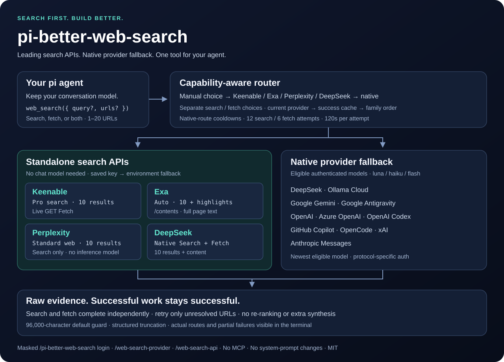

# Architecture

`pi-better-web-search` adds one tool and keeps the provider boundary thin. The
extension owns exposure, provider selection, fallback, caching, and a small
output guard. It does not own provider result cleanup.



## Design principles

1. **One model-facing tool, no skills.** The extension registers only
   `web_search`. It does not install, register or ship skills; vendor reference
   files must not live in this checkout's agent skill-discovery directories.
2. **Expose only what can work.** The tool is hidden when neither the current
   model nor an authenticated compatible provider can search, and no standalone
   search API is configured.
3. **Trust provider output.** Search results, citations, metadata, and fetched
   pages are returned as provider data, not rewritten into a normalized shape.
4. **Use provider-native interfaces.** Each family keeps its request shape,
   authentication quirks, and stream format.
5. **Strict lightweight routing.** Only OpenAI `luna`, Claude `haiku`, and
   other brands' `flash` models are eligible for model-backed routes. Standalone
   APIs and pi-authenticated DeepSeek native tools are tier-independent. Prefer
   an explicit user selection, then configured
   APIs, then current-provider/cache/family routing. Model hints reselect eligible
   models and cannot bypass tier rules.
6. **Do not touch pi's system prompt.** No prompt snippets, guidelines, loadout
   hooks, or extra tools. Terminal-only commands handle login, API settings,
   and per-phase provider preferences.

## Runtime flow

```text
extension factory
  ├─ register web_search with defaultActive: false
  ├─ register /pi-better-web-search login|logout|status
  ├─ register /web-search-api [parallel|deepseek|exa|keenable|perplexity]
  └─ register /web-search-provider [search|fetch]

session_start / session_tree / model_select / before_agent_start
  └─ sync(ctx)
       ├─ resolve current candidate + authenticated available candidates
       ├─ read explicit provider preferences + success cache + available-model fingerprint
       ├─ decide expose, allowUrls, and whether Parallel locks the schema/routing
       ├─ re-register the same tool name if the schema variant changed
       └─ add/remove web_search from the active tool set

tool execute
  ├─ parse normal query/urls or Parallel objective/search_queries/urls
  ├─ run the selected candidate (Parallel is exclusive while active)
  ├─ run fetch candidates per URL until each URL succeeds or candidates end
  ├─ write search/fetch preferences + fingerprint on success
  └─ format raw JSON; compact or structurally truncate if the guard is exceeded
```

## Terminal credentials

`/pi-better-web-search login` selects Parallel, DeepSeek, Exa, Keenable or
Perplexity and opens a local-only masked `SecretInput`. It never delegates to the
plaintext input renderer or accepts a key argument. Login saves a literal key in the
separate `better-web-search-auth.json` credential file (mode 0600 where
supported, atomic locked writes, **not encryption**), enables the standalone
API and resyncs exposure immediately. The saved key precedes its environment
fallback. No authentication test request is made on login. Status shows
presence only; logout confirms removal and disables the standalone interface
without changing global pi/model credentials or silently enabling public access.

Standalone DeepSeek uses the existing native adapter and official base URL with
an internal routing identity, without requiring a registered chat model. Native
model candidates retain their existing tier/auth behavior; they are not promoted
as standalone interfaces merely because they share the `deepseek` provider id.

## Exposure

A candidate is a supported lightweight chat model, a configured standalone
retrieval API, or pi-authenticated DeepSeek native tools, all implementing
`ProviderAdapter`. API-only candidates have internal cache/health identities,
not actual inference models.
The tool is exposed when:

- the current conversation model has the required lightweight tier and maps to
  a supported family; or
- `modelRegistry.getAvailable()` contains at least one supported lightweight model; or
- pi's registry reports configured `deepseek` auth and a native provider endpoint,
  even when no eligible chat model is available; or
- a saved-key or environment-configured retrieval API (or explicitly enabled public
  Keenable) is available, without requiring a model registry entry.

`urls` is exposed only when at least one **usable** URL-capable candidate
exists. A current model outside `getAvailable()` must prove registry or
environment authentication. This prevents advertising URL analysis based on an
unauthenticated model.

The tool is registered with `defaultActive: false`. The sync logic adds it to the
active tool set only after the exposure check passes. When the tool is
unavailable, it is removed from the active set; it remains registered under the
same name so a later login or model change can activate it again without
creating a second tool.

The sync logic also remembers an explicit user change to the active set. If the
user removes `web_search` through pi's tool UI, later model changes do not
silently re-add it.

## Candidate ordering

An explicit per-phase provider preference is inserted first when authenticated,
supported, and lightweight for inference-backed routes. This is not a filter: all automatic fallback remains
available, and the explicit preference is tried first even after failures.

An active Parallel API is special: its official `objective` /
`search_queries` / `urls` schema is incompatible with normal `query` / `urls`,
so it becomes the only candidate for both phases. No provider fallback or
provider-priority picker is available until Parallel is disabled.

Configured Keenable, Exa, Perplexity, then standalone DeepSeek come next, ahead
of current/cache hints; fetch skips Perplexity. Exa search sends
`numResults: 10` and nested `contents.highlights: true`; its `/contents` fetch
batches URLs with top-level `text: true` and checks per-URL statuses. Only failed
URLs continue to fallback. No new model-facing parameter or system-prompt
guidance is introduced. Each service has one candidate; no API request sends its
internal identity as a model name. Perplexity is search-only,
uses standard `search_type: "web"`, and never invokes Agent/Orchestrator APIs.
The original automatic model order then follows:

1. The newest eligible lightweight model of the current provider.
2. The newest eligible lightweight model of the remembered search provider
   when the cache fingerprint is current.
3. One candidate per remaining family in this order:
   **DeepSeek → Ollama → Google → OpenAI → xAI → Anthropic**.
4. Prefer previously unrepresented provider ids, then try remaining sibling
   models round-robin across families. Provider-wide failures skip that
   provider; model-specific failures, including model-access 403s, can use a
   sibling model. Search allows one initial attempt plus six fallback attempts;
   skipped candidates do not count.

Fetch candidates use the same shape but include only adapters with
`supportsUrls` and a `fetch` implementation. Fetch has the same 7-attempt cap.
Cooldowns reorder automatic model routes before either cap, without moving them ahead of standalone APIs or the explicit preference.

Standalone API adapters are explicitly exempt from chat-model tier ranking.
For model-backed adapters, only `luna` (OpenAI), `haiku` (Claude), or `flash`
(all other brands) models enter either candidate list. No base, pro, larger named tier, or unknown tier is
used as a fallback. Within a family, models are ordered by brand first:
DeepSeek, OpenAI, Claude, Gemini/Gemma, then other gateway brands. Within each
brand, numeric versions sort newest first. Claude dotted and dashed minors are
both supported, and date suffixes are ignored. Brand/version recognition is
independent of API family, including namespaced gateway IDs. Ties fall back to
the deterministic `provider/id@baseUrl` order. Ranking only applies to models whose API is already
supported. For example, built-in `opencode-go` DeepSeek models use
`openai-completions` and are not eligible for Responses search.
A provider id is only retried with another model when the first failure was
model-specific; provider-wide failures (auth, balance, network, timeout,
malformed request) skip the rest of that provider. Provider failures and
model-specific failures are remembered per phase (search/fetch) for the life of
the process. On later calls failed automatic model routes move behind healthy
model routes for a 60-second to 10-minute exponential cooldown. Concurrent
failures during an active cooldown count as one outage; a failed probe after
expiry increases the cooldown. A successful search or fetch with at least one
successful URL and no provider transport error clears it. Calls already in
flight are not cancelled or reordered.

The current model and cache entries are provider hints, not pinned model
choices. Both reselect the newest eligible model from the discovery snapshot.
The current provider hint is retained even when the conversation model's API
is unsupported; only its eligible, supported siblings can be requested.
Discovery and its fingerprint use the same single registry snapshot.
A supported current lightweight model can participate even if absent from the
registry. Health cooldowns can move failed models behind healthy lightweight
fallbacks; no cooldown can reintroduce an excluded tier.

## Terminal rendering

`lib/render.ts` distinguishes Web Search, Web Fetch (URLs only), and combined
calls. Successful operation metadata is in `details.routes`; progress includes
`details.activeRoute`. `lib/routes.ts` describes the actual API operation.
DeepSeek and Ollama routes include the standalone endpoint and omit `model`,
because the request contains no inference-model parameter. Existing
`details.model` and cache refs still identify credential-selection candidates.
The terminal never uses these legacy fields as native API model labels.
Collapsed results show routes, fetched counts, failed URL counts
(`details.fetchFailedCount`), and truncation warnings. Expanded results also show
the untouched raw model-facing content. Errors and partial updates stay visible.
DeepSeek/Ollama preserve completed URLs after a later global HTTP or transport
failure; only unresolved URLs are sent to fallback providers.

## Explicit provider preferences

`lib/provider-command.ts` registers `/web-search-provider [search|fetch]` using
pi's terminal select dialogs. Search and fetch choices are independent. The
picker lists one newest eligible candidate per authenticated provider, without
attempt caps; fetch excludes search-only adapters. Native endpoints are shown
without implying an inference-model request. Auto removes a phase preference;
cancellation writes nothing. Missing providers remain visible as unavailable.

`lib/preferences.ts` stores `{ version: 1, search?: string, fetch?: string }` in
`better-web-search-settings.json` under pi's agent directory (override with
`PI_BETTER_WEB_SEARCH_SETTINGS`). Only provider ids and dedicated API toggles are
serialized; credentials live in a separate file. Invalid or
unreadable settings use automatic routing; save failures are reported by the UI.
Settings are read for each discovery snapshot and are independent of the success
cache and its fingerprint, so fallback successes never overwrite explicit choices.
Unavailable choices are ignored until they become eligible again.

## Cache and fingerprint

Default cache path:

```text
~/.pi/agent/better-web-search.json
```

Override with `PI_BETTER_WEB_SEARCH_CACHE`. The cache contains:

```ts
{
  version: 1;
  fingerprint?: string;
  search?: { provider: string; model: string };
  fetch?: { provider: string; model: string };
}
```

The fingerprint is a SHA-256 prefix over sorted
`provider/model@baseUrl` values for authenticated chat models plus available
standalone API identities and their credential source/public mode. It contains
no keys or key hashes. When the fingerprint changes, cached preferences are ignored for that call and provider
discovery starts again. The cache is rewritten only after a successful search
or fetch. Credentials are never written.

A cache entry is resolved only against the current authenticated model list.
If the exact model is gone, another available model of the same provider id can
be used. A cached provider that is no longer available is ignored.

## Input validation

- `query` is trimmed. When DeepSeek is selected, queries over 128 Unicode
  characters produce an actionable error before any DeepSeek request; no
  automatic truncation, fallback, or health cooldown occurs. Other providers
  are not subject to this limit.
- Both schema variants set `additionalProperties: false`; unknown top-level
  arguments are also rejected at runtime before provider discovery or requests.
- When supplied, `urls` is an array of 1–20 strings. Schema items have
  `minLength: 1` and `maxLength: 8192`, using the shared `MAX_URL_LENGTH` constant.
- Each URL must be HTTP/HTTPS, have a host, omit username/password, and be at
  most 8192 Unicode code points. Native DeepSeek uses the same length bound.
- Only the URL-capable variant's description and query field advise fetching
  supplied URLs; query-only descriptions do not advertise unavailable fetch.
  Both variants prefer natural-language retrieval intent, relevant time
  scope/source preferences, source verification/citation, and query refinement
  when evidence is insufficient. This is tool-description guidance, not a
  system-prompt change, a global query-length cap or an automatic research loop.
- At least one non-empty query or valid URL is required.
- Invalid URLs are reported in `fetched` entries when other work is valid.
  If no valid work remains, the tool returns an error.

Search and fetch have separate candidate lists and independent failure outcomes.
A search-only current model can search while a URL-capable provider handles the
URLs. Ordinary search failures, including missing search capability and query
length rejection, do not prevent independently requested fetching. A missing
fetch interface becomes a per-URL error when search succeeded. Only invalid
request structure, explicit cancellation, or no successful requested operation
prevents a success/partial-success return.

## Output

The result is a JSON wrapper:

```ts
{
  search?: {
    error?: string; // Search failed, but another requested operation succeeded.
    answer?: string;
    results?: unknown;
    citations?: unknown;
    searchQueries?: string[];
    groundingMetadata?: unknown;
    urlContextMetadata?: unknown;
  };
  fetched?: Array<{
    url: string;
    data?: unknown;
    error?: string;
  }>;
}
```

All final content blocks are `type: "text"`. Success and partial success use
JSON with `isError` omitted; complete failure uses natural-language error text
and `isError: true`. `search.error` and `fetched[].error` describe failed work
without replacing successful results. Search-only query-length errors retain
the actionable text without a `Failed: ` prefix. Progress is not a final return.
`details.searchError` lets collapsed terminal results disclose a failed search
without treating a successful fetch as a whole-call error.

Fields inside a successful `search` and `fetched[].data` are provider data. The
extension does not deduplicate,
normalize, filter, re-rank, summarize, insert citation markers, or append source
sections. The final guard keeps model-facing results and errors within 96,000
Unicode code points by default (`PI_BETTER_WEB_SEARCH_MAX_CHARS`).
It preserves ordinary formatted JSON, or uses compact JSON if that alone fits.
Otherwise it budgets sibling fields and array entries independently. Recognized
link and identity fields stay whole; entries or branches that cannot fit them
are omitted instead, without re-ranking. Standalone URLs and link/citation array
entries remain intact, and a recognizable URL crossing a text cut is omitted
rather than partially emitted. Unknown relative links or bare domains may not be
identifiable. Other strings can be shortened, and fields or trailing array entries
omitted. The JSON portion
stays valid, followed by one `[truncated]` line; the complete text is therefore
not valid JSON. No output-size truncation metadata is injected into the JSON;
`details.truncated` marks output-size data loss. When truncation is needed with a limit of 11–13 characters,
only the marker is returned; below 11, a minimal JSON value is returned instead.
This is a character guard, not a token or model-context limit; it does not
provide pagination or retain the complete provider payload for later use.

## Provider adapter contract

```ts
interface ProviderAdapter {
  family: ProviderFamily;
  label: string;
  supportsSearch: boolean;
  supportsUrls: boolean;
  search(
    ctx: ExtensionContext,
    model: Model<Api>,
    query: string,
    signal: AbortSignal | undefined,
    onUpdate?: AgentToolUpdateCallback,
  ): Promise<ProviderSearchResult>;
  fetch?(
    ctx: ExtensionContext,
    model: Model<Api>,
    urls: string[],
    query: string | undefined,
    signal: AbortSignal | undefined,
    onUpdate?: AgentToolUpdateCallback,
  ): Promise<ProviderFetchResult>;
}
```

`search()` throws when the provider did not perform a search. `fetch()` returns
one entry per requested URL; per-URL failures go in `entry.error`. Both honor
the abort signal and resolve credentials through `lib/auth.ts`.

## File map

| Path | Responsibility |
| --- | --- |
| `extensions/index.ts` | Tool registration, exposure sync, lifecycle handlers |
| `lib/candidates.ts` | Current/available candidates, ordering, cache resolution |
| `lib/search.ts` | Input validation, search/fetch fallback, cache writes, output |
| `lib/health.ts` | Provider-wide failure cooldowns and candidate reordering |
| `lib/auth.ts` | Credential resolution, header merging, env fallback |
| `lib/cache.ts` | Preference cache and model-set fingerprint |
| `lib/families.ts` | Provider family detection |
| `lib/schema.ts` | Query-only and query+urls schema variants |
| `lib/format.ts` | JSON wrapper, output guard, success/error results |
| `lib/providers/` | Provider adapters, SSE reader, HTTP helpers |

## Non-goals

- Rewriting provider answers or search results.
- Exposing a second tool or changing pi's system prompt.
- Reusing credentials for a provider the user has not authenticated.
- Retrying the same provider indefinitely on rate limits or server errors.
- Providing telemetry or a hosted search service.

For the original implementation handoff and detailed invariants, see the
internal [`DESIGN.md`](https://github.com/zhexusun10/pi-better-web-search/blob/main/DESIGN.md)
in the repository.
